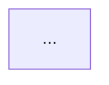

# Output Templates

Table of contents: 1 x-ray.md, 2 entry-points.md, 3 invariants.md and the synthesis taxonomy, 4 account-graph.md, 5 risk rubric, 6 verdict tiers.

Style rules for every file: one tight line per bullet (two at most), code references carry the evidence, no filler, no severity labels in the surface list, no exploit chains in the surface list ("worth checking ..." not "attacker drains ...").

---

## 1. x-ray.md

```markdown
# X-Ray Report

> {Protocol} | {total nSLOC} nSLOC | {short-hash} (`{branch}`) | {Anchor/native + versions} | {DD/MM/YY}

## 1. Protocol Overview

**What it does:** {one sentence, the core mechanism}

- **Users**: {who interacts and why}
- **Core flow**: {main user operation, one bullet}
- **Key mechanism**: {constant product, virtual-reserve curve, fee layers, graduation rule}
- **Token model**: {mints, LP tokens, authorities who hold what}
- **Admin model**: {roles, holders, multisig or EOA, timelocks}

### Programs in Scope
| Program | Program id | Instructions | nSLOC | Role |
|---|---|---:|---:|---|

### How It Fits Together
{Start with "The core trick:" one sentence. Then 3 to 5 flows as tree-style call chains with the accounts that matter and italic notes where state changes, where CPIs fire, where value moves. Use concrete program and instruction names.}

## 2. Threat & Trust Model

### Protocol Threat Profile
> Classified as: **{primary}** with **{secondary}** characteristics. {one or two sentences of evidence}

### Actors & Privilege Register
| Role | Holder type | Stored at | Rotation | Instant powers | Delayed powers | Reaches user funds? |
|---|---|---|---|---|---|---|
{Only roles that exist in code or deployment scripts. Cells under two lines. "Reaches user funds" is yes / no / bounded (cap) with the instruction.}

**Adversary ranking** (profile-ordered, adjusted by git evidence), one sentence each: who they are and why they matter here. No mechanics.

### Trust Boundaries
{Per boundary: what is trusted, what it can do if wrong, what pins it (typed program, constant, seeds), delay or multisig. One to two lines each.}

### Upgrade & Deployment
- Upgrade authority at launch: {holder, timelock, plan to rotate or revoke}
- Verified build / `security.txt` / IDL authority: {present or not}
- Program id and keypair handling: {where it lives, `declare_id!` matches Anchor.toml?}

### External CPIs
| Call site | Callee | Callee pinned by | Signer seeds | Accounts forwarded | Reload after | Notes |
|---|---|---|---|---|---|---|

### Key Attack Surfaces (ranked)
{Sorted by the score in section 5, not alphabetical. Cross-link invariant ids.}
- **{Surface}** &nbsp;&#91;[X-4](invariants.md#x-4), [I-17](invariants.md#i-17)&#93; (score {n}) — {file:line}: {what is unusual and what to trace to confirm or dismiss}

{Examples of framing. Good: "Graduation moves the curve's reserves into a pool with a caller-independent address; worth checking what happens when that address already exists (migrate.rs:88)". Bad: "attacker pre-creates the pool and the migration reverts forever".}

### Protocol-Type Concerns
{Only items not already in the surface list: rounding direction per path, curve edge cases, fee base consistency. Two to three bullets per type, each citing code.}

### Temporal Risk Profile
{Only phases that add information: deployment and initialization, launch peak, graduation, key rotation, wind-down. One to three bullets each.}

### Environment Constraints
| Constraint (chain fact) | Code that assumes the opposite or fails to reject | Where |
|---|---|---|

## 3. Invariants
> Full map: **[invariants.md](invariants.md)**. {N} guards, {N} single-program, {N} cross-program, {N} economic. The **On-chain = No** rows are the high-signal ones.

## 4. Documentation Quality
| Aspect | Status | Notes |
|---|---|---|
| README | | |
| Specs / design docs | | |
| Doc comments (`///`) | | |
| Chain facts / toolchain docs | | |

## 5. Test Analysis
Test counts come from the Phase 1 file scans (always reliable). Coverage numbers appear only if a run finished; a failed run never implies absent tests.
| Metric | Value | Source |
|---|---|---|
| Rust unit tests | | scan |
| TS/JS integration test files | | scan |
| LiteSVM / Mollusk / program-test files | | scan |
| Property / fuzz (proptest, Trident, cargo-fuzz) | | scan |
| Formal verification (Certora CVLR) | | scan |
| Line coverage | N% / pending / unavailable (reason) | tool |
### Gaps
{Only missing categories, ordered by audit impact: stateful fuzz and invariant tests for math and accounting come first; then regression tests for every past fix; then adversarial-account tests (wrong owner, duplicate accounts, fake sysvar).}

## 6. Developer & Git History
> Repo shape: {normal_dev | squashed_import} — {one sentence}
{Analyzed branch and commit. Contributors, hotspots, fix-like commits touching programs, late changes to privileged or math code, forked dependencies and the upstream commit they track, TODO/FIXME in value paths. Cross-reference synthesis: two to four lines of the form "signal A + signal B -> where to look".}

## X-Ray Verdict
**{TIER}** — {one-sentence justification}
**Structural facts:** {three to five measurable facts only; no security claims}
```

---

## 2. entry-points.md

```markdown
# Entry Point Map
> {Protocol} | {N} instructions | {N} permissionless | {N} role-gated | {N} admin-only

## Protocol Flow Paths
{15 to 30 lines of arrow chains grouped by actor. Trace each destination backwards through the state its preconditions read, with `◄──` for non-instruction preconditions (time, liquidity, threshold reached).}

## Permissionless
### `program::instruction`
| Aspect | Detail |
|---|---|
| Accounts the caller chooses | {list with the binding check each has, or NONE} |
| Signers | |
| Parameters | {name (user-controlled) / (protocol-derived) / (admin-set)} |
| CPIs | {callee, pinned by} |
| State modified | |
| Value flow | tokens/lamports: from -> to / none |
| Pause check | yes / no |
{Only permissionless instructions get the full block. Sort: value in, value out, no movement.}

## Role-Gated
{Group by role. Use the same table for up to 10 instructions, then a compact table.}

## Admin-Only
| Program | Instruction | Parameters | State modified | Reaches user funds? |
|---|---|---|---|---|
```

---

## 3. invariants.md

Use `#### G-N`, `#### I-N`, `#### X-N`, `#### E-N` heading blocks, not tables (heading anchors are the targets of cross-links).

```markdown
# Invariant Map
> {Protocol} | {N} guards | {N} inferred | {N} not enforced on-chain

## 1. Enforced Guards (reference)
#### G-1
`require!(...)` or `constraint = ...` · `file.rs:LN` · {purpose: what trust boundary or invariant it protects}

## 2. Inferred Invariants (single program)
#### I-1
`Category` · On-chain: **Yes/No**
> {global property}
**Derivation** — {one of: Δ-pair a.rs:Lx ↔ a.rs:Ly | guard-lift: <guard> + <all write sites> | edge: State@Lx → State@Ly | temporal: <predicate> | doc: "<quote>" (per spec)}
**If violated** — {consequence}
**Fuzz hint** — {property name for solana-fuzz, e.g. `prop_k_never_decreases`}

## 3. Inferred Invariants (cross-program)
#### X-1
On-chain: **Yes/No**
> {what the caller assumes about the callee's result or state}
**Caller side** — `a.rs:LN` — {use}
**Callee side** — `b.rs:LN` — {write sites that could break it}
**If violated** — · **Fuzz hint** —

## 4. Economic Invariants
#### E-1
On-chain: **Yes/No**
> {property}
**Follows from** — `I-3` + `I-7` [+ `X-2`]
**If violated** — · **Fuzz hint** —
```

**Taxonomy and walk order** (each step uses raw extraction, not earlier conclusions):
1. *Conservation*: delta pairs in one instruction body, `Δ(A)=+x` and `Δ(B)=-x` -> `A+B=const` or `A == Σ B[key]`. Token flows count: `vault.amount` delta against `reserve` delta. Missing delta where one is expected (flash loan, fee) is a negative-conservation finding.
2. *Guard extraction and lift*: every `require!`, constraint and error return becomes a `G-N` line verbatim. Lift each to a global property if it constrains persistent state, then grep every write site of that field. All sites guarded -> `I-N`, On-chain Yes. Any site without an equivalent guard -> On-chain **No**, citing the site.
3. *Ratio*: `A = B * C / D` over state fields; note snapshot ordering and rounding direction.
4. *State machine*: `require(state == X); state = Y`. One-shot latches versus togglable flags (drop togglables). Include graduation, pause, initialized, closed.
5. *Temporal*: comparisons of stored time or slot values with the clock.
6. *Cross-program*: a CPI result or foreign account used in arithmetic or a write, and the callee's write sites for that state. Both sides in scope only.
7. *Economic*: combinations implying a higher-order property (no profit from round trips, vault solvency, no admin fund path). Each cites verified ids; a gap in a source invariant makes it On-chain No.

Solana additions: for each token account the program holds, record the invariant `vault.amount >= books + accrued fees` (pre-reload warning if the code reads `amount` after a CPI without `reload()`); for each PDA the invariant "exactly one valid address for this role"; for each `close`, "closed accounts cannot be revived".

---

## 4. account-graph.md

```markdown
# Account Graph
## PDAs
| PDA | Seeds | Canonical bump stored? | Creator ix | Closer ix | Signs for | Holds |
|---|---|---|---|---|---|---|
## Cross-references
| From (account.field) | To | Enforced by | Unenforced? |
|---|---|---|---|
## Diagram

```

---

## 5. Attack-surface risk rubric

Score = value reach + caller privilege + complexity + churn + test gap (0 to 3 each, maximum 15). Sort descending; break ties by value reach.
- *Value reach*: 3 can move or freeze user vault funds or mint supply; 2 can change economics of others; 1 affects only the caller; 0 none.
- *Caller privilege*: 3 permissionless; 2 any token creator or LP; 1 role-gated; 0 upgrade authority only.
- *Complexity*: 3 hand-rolled math, CPI chains or manual deserialization; 2 several accounts and PDA signing; 1 typed accounts, simple state; 0 trivial.
- *Churn*: 3 hotspot with fix-like commits or late changes; 2 hotspot; 1 some changes; 0 stable.
- *Test gap*: 3 no tests on the path; 2 happy path only; 1 adversarial cases exist; 0 fuzz or invariant tests.

## 6. Verdict tiers

Take the lowest of the three signals; drop one tier if TODOs sit in value paths.
- *Tests*: EXPOSED no tests; FRAGILE unit only; ADEQUATE unit + (property or fuzz); HARDENED unit + fuzz + invariant tests; FORTIFIED + formal verification.
- *Docs*: EXPOSED none; FRAGILE sparse comments; ADEQUATE comments + README; HARDENED + spec; FORTIFIED + thorough inline invariants.
- *Access control*: EXPOSED unclear roles; FRAGILE roles but single hot key or no timelock; ADEQUATE roles clear, multisig; HARDENED + timelock on economics and upgrades; FORTIFIED + exits-never-paused and verified builds.
The verdict describes structure and process, not security.
